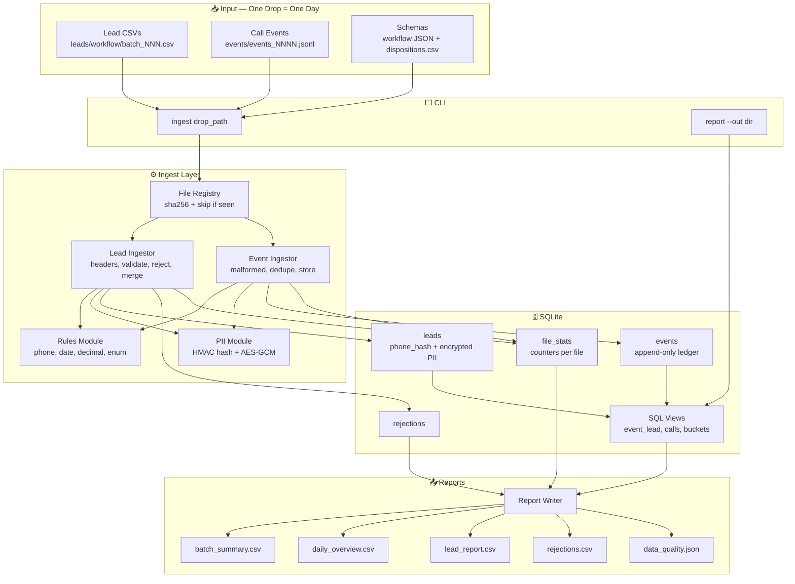
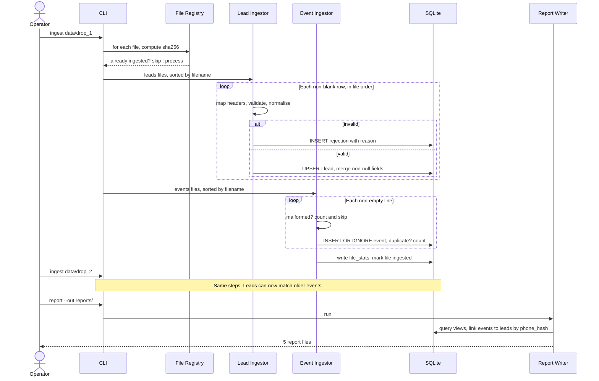
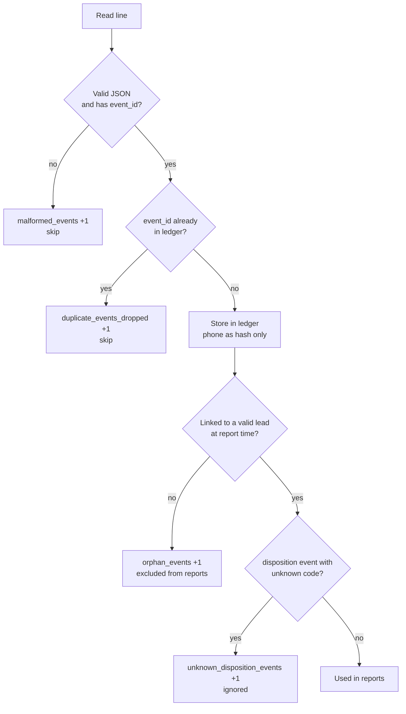
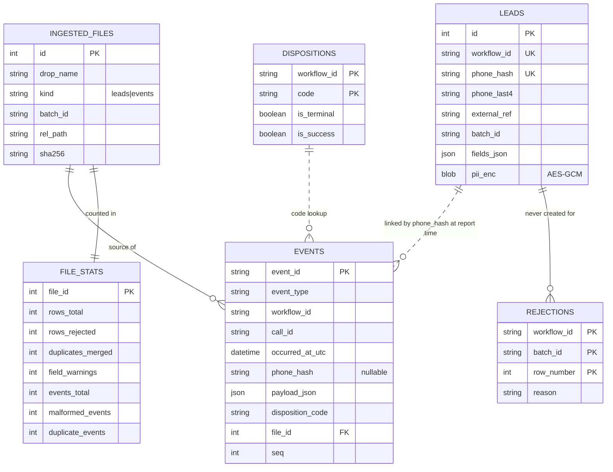

# Interaction Ledger — Design & Architecture

> Batch data pipeline. Cleans lead CSVs, records call events in an append-only ledger, links the two with hashed phone numbers, and writes five exact report files. CLI + SQLite + pure-Python rules. No AI, no ML.

---

## 1. High-Level Architecture



**Core idea:** ingest only *stores* facts. Everything that depends on other data (linking, orphans, buckets) is computed at **report time** from the database. That is what makes late-arriving leads and idempotent re-runs work.

---

## 2. Data Flow — Ingest Then Report



### Event gatekeeper (the order matters)



---

## 3. Directory Structure

```
interaction-ledger/
├── pipeline/
│   ├── cli.py                 # `ingest` and `report` commands (argparse)
│   ├── config.py              # DB path, secret keys from env
│   ├── db.py                  # connection, PRAGMAs, schema bootstrap
│   ├── schema.sql             # tables, indexes, triggers, views
│   ├── pii.py                 # phone HMAC, AES-GCM encrypt/decrypt
│   ├── rules/
│   │   ├── headers.py         # header normalisation + alias match
│   │   ├── phone.py           # canonical +91XXXXXXXXXX or invalid
│   │   ├── dates.py           # 4 date formats, day-first
│   │   ├── decimals.py        # ₹ / Rs / INR, commas, round 2
│   │   └── timestamps.py      # Z / offset / naive-as-IST → UTC, IST dates
│   ├── ingest/
│   │   ├── registry.py        # ingested_files, sha256, skip logic
│   │   ├── leads.py           # validate, reject, merge
│   │   └── events.py          # parse, dedupe, store
│   ├── domain.py              # bucket + effective disposition (pure, tested)
│   └── reports/
│       ├── queries.sql        # aggregation in SQL
│       └── writer.py          # exact CSV/JSON output
├── tests/
│   ├── test_phone.py
│   ├── test_dates.py
│   ├── test_decimals.py
│   ├── test_effective_disposition.py
│   ├── test_buckets.py
│   ├── test_idempotency.py    # drop_1 twice, and split vs all-at-once
│   └── test_reports_golden.py
├── schemas/                   # given
├── tools/generate_data.py     # given
├── SUBMISSION.md
├── AI_USAGE.md
├── README.md
└── .env.example
```

---

## 4. Tech Stack Reference

### Layer 1 — Language & CLI

| Tech | Role | Notes |
|------|------|-------|
| **Python 3.11+** ✓ | Everything | Stdlib covers CSV, JSON, hashing, dates |
| **argparse** ✓ | `ingest` and `report` commands | Alt: Typer |

### Layer 2 — Storage

| Tech | Role | Notes |
|------|------|-------|
| **SQLite** ✓ | The real database | WAL mode, `STRICT` tables, zero setup |
| **sqlite3 (stdlib)** ✓ | DB access with plain SQL | Keeps aggregation in SQL |
| **PostgreSQL** | Alternative | Only if you want to show it. Same schema works |

### Layer 3 — Processing

| Tech | Role | Notes |
|------|------|-------|
| **csv + json (stdlib)** ✓ | Reading input | Streams row by row, low memory |
| **datetime + zoneinfo** ✓ | Timestamps | IST = `Asia/Kolkata` (no DST) |
| **decimal (stdlib)** ✓ | Money rounding | Avoid float errors |
| **pandas** ✗ | Not used | Rules are order-sensitive; plain loops are safer |

### Layer 4 — Security (PII)

| Tech | Role | Notes |
|------|------|-------|
| **hmac + hashlib** ✓ | Keyed hash of phone for matching | HMAC-SHA256, key from env |
| **cryptography (AES-GCM)** ✓ | Encrypt other PII fields | One encrypted blob per lead |
| **python-dotenv** | Load keys locally | Dev only |

### Layer 5 — Quality

| Tech | Role | Notes |
|------|------|-------|
| **pytest** ✓ | Unit + integration tests | Golden-file tests on seed 42 |
| **ruff** | Lint + format | Optional |

---

## 5. Database Schema

```sql
-- Which files were already ingested (idempotency)
ingested_files (
  id INTEGER PK,
  drop_name TEXT, kind TEXT,          -- 'leads' | 'events'
  workflow_id TEXT NULL,              -- leads only
  batch_id TEXT NULL,                 -- file stem, leads only
  rel_path TEXT, sha256 TEXT,
  ingested_at TEXT,
  UNIQUE (drop_name, rel_path)
)

-- Counters per file (summed for data_quality.json)
file_stats (
  file_id INTEGER PK REFERENCES ingested_files(id),
  rows_total, rows_rejected, duplicates_merged, field_warnings,   -- leads
  events_total, malformed_events, duplicate_events                -- events
)

-- Disposition catalogue (loaded from dispositions.csv)
dispositions (workflow_id, code, is_terminal, is_success, PRIMARY KEY (workflow_id, code))

-- Leads. No plaintext PII.
leads (
  id INTEGER PK,
  workflow_id TEXT,
  phone_hash TEXT,          -- HMAC-SHA256(canonical phone)
  phone_last4 TEXT,         -- for masking in lead_report
  external_ref TEXT,        -- the schema field marked "reference"
  batch_id TEXT,            -- first file stem, never changes
  fields_json TEXT,         -- non-PII fields after merge + defaults
  pii_enc BLOB,             -- AES-GCM blob of fields marked pii: true
  UNIQUE (workflow_id, phone_hash)
)

-- Rejected rows. No PII, only the reason.
rejections (
  workflow_id, batch_id, row_number, reason,
  PRIMARY KEY (workflow_id, batch_id, row_number)
)

-- Append-only ledger. Never updated, never deleted.
events (
  event_id TEXT PRIMARY KEY,
  event_type TEXT,
  workflow_id TEXT,
  call_id TEXT,
  occurred_at_utc TEXT,     -- always normalised to UTC
  phone_hash TEXT NULL,     -- NULL for overrides or invalid phones
  payload_json TEXT,
  disposition_code TEXT NULL,
  file_id INTEGER REFERENCES ingested_files(id),
  seq INTEGER               -- ingest order, used for stable tie-breaks
)
-- TRIGGER: RAISE(ABORT) on UPDATE or DELETE of events
```

### Views (the report logic lives here)

| View | What it gives |
|------|---------------|
| `event_lead` | Event → lead via `(workflow_id, phone_hash)` |
| `call_lead` | `call_id` → lead, taken from the call's phone-bearing events (this is how overrides link) |
| `calls` | One row per call that has a linked `call.initiated`: date (IST), connected flag, all-failed flag |
| `call_effective_disposition` | Latest override, else latest set, ignoring unknown codes |
| `lead_buckets` | The four buckets per lead |

### ER diagram



---

## 6. PII Design

| Data | How it is stored | Why |
|------|------------------|-----|
| Phone (for matching) | `HMAC-SHA256(canonical_phone, PII_HMAC_KEY)` | Same phone always gives the same hash, so events still match leads. Can't be reversed or brute-forced without the key |
| Phone (for masking) | Last 4 digits only | The report only needs `+91******1234` |
| Other `pii: true` fields | One AES-GCM encrypted blob (`PII_ENC_KEY`) | Not readable in the DB file |
| Event phone | Hash only. Raw phone is never written | The ledger must not hold plaintext PII either |
| Rejections | Row number + reason only | The contract says no PII |

Keys come from environment variables. They are never committed. A plain unkeyed SHA-256 is **not** enough, because Indian mobile numbers are only about 4 billion values and can be brute-forced quickly.

---

## 7. Core Logic Design

### Phone normalisation (pure function)

```python
# pipeline/rules/phone.py
import re

def normalise_phone(raw: str) -> str | None:
    digits = re.sub(r"\D", "", raw or "")
    if len(digits) == 12 and digits.startswith("91"):
        digits = digits[2:]
    elif len(digits) == 11 and digits.startswith("0"):
        digits = digits[1:]
    if len(digits) == 10 and digits[0] in "6789":
        return f"+91{digits}"
    return None
```

### Effective disposition and bucket (pure, unit tested)

```python
# pipeline/domain.py
def effective_disposition(sets, overrides):
    """sets / overrides: lists of (occurred_at_utc, seq, code), unknown codes already removed."""
    pool = overrides or sets
    return max(pool)[2] if pool else None        # latest by time, then ingest order

def bucket(calls, is_terminal):
    if not calls:
        return "yet_to_reach_out"
    if any(c.disposition and is_terminal(c.disposition) for c in calls):
        return "completed"
    if all(c.had_telephony_failed for c in calls):
        return "in_progress_telephony_failed"
    return "in_progress_dialed"
```

In practice the same logic runs as SQL views. The Python version is the readable spec and the test oracle.

### Lead merge rule

1. First valid row for `(workflow_id, phone_hash)` creates the lead. Its file stem becomes `batch_id` forever.
2. Later valid rows count as `duplicates_merged` and overwrite **only non-null** fields.
3. Defaults (like `preferred_language = en`) apply after merging, only to fields still null.

---

## 8. Idempotency & Incremental Design

| Risk | Defence |
|------|---------|
| Same drop ingested twice | `ingested_files` unique on `(drop_name, rel_path)`. Already-seen files are skipped |
| Same file renamed or re-delivered | `sha256` check. A matching hash is skipped and logged |
| Duplicate events across drops | `event_id PRIMARY KEY` with `INSERT OR IGNORE`. If the insert changes no rows (`rowcount = 0`), it counts as a duplicate |
| Crash halfway through a file | The whole file runs in **one transaction**. The registry row commits with it |
| Events before their lead | Events are stored unlinked. Linking happens at report time through views |
| drop_1 + drop_2 equals all at once | Files always processed in sorted order. Reports are a pure function of DB state |

**Trade-off:** `report` recomputes everything from the DB each run. That is cheap (seconds on the large dataset) and removes a whole class of stale-cache bugs. True incremental reports would be a stretch goal.

---

## 9. Report Generation

Each report is one SQL query over the views. Python only writes the files.

| File | Source | Sort |
|------|--------|------|
| `batch_summary.csv` | `lead_buckets` grouped by `(workflow_id, batch_id)` | workflow_id, batch_id |
| `daily_overview.csv` | `calls` grouped by `(workflow_id, ist_date)`. `connectivity_rate` formatted `%.4f` | workflow_id, date |
| `lead_report.csv` | `leads` + `lead_buckets` + call aggregates. Phone masked as `+91******` + last4 | workflow_id, external_ref |
| `rejections.csv` | `rejections` | workflow_id, batch_id, row_number |
| `data_quality.json` | Sums of `file_stats`, plus orphans computed from final DB state | n/a |

Output rules: header row, `,` delimiter, `\n` line endings, `true`/`false` booleans, no index column, dates in IST, `last_call_at` as `2026-10-14T17:55:24+05:30`.

---

## 10. Phased Implementation Plan

### Phase 1 — Rules & Foundation (Hours 0–3)
**Goal:** Pure functions work and are tested

- [ ] Repo skeleton, `.env.example`, `README.md`
- [ ] `rules/headers.py` (lower, trim, collapse `_` and whitespace)
- [ ] `rules/phone.py` with tests for all six formats
- [ ] `rules/dates.py` (4 formats, day-first, impossible dates)
- [ ] `rules/decimals.py` (₹, Rs, Rs., INR, commas, round 2, ≥ 0)
- [ ] `rules/timestamps.py` (Z, offset, naive-as-IST)

**Deliverable:** `pytest` green on every parser.

---

### Phase 2 — Schema & Lead Ingest (Hours 3–7)
**Goal:** Leads in the DB, rejections correct

- [ ] `schema.sql`, `db.py`, load `dispositions` and workflow schemas
- [ ] `pii.py` (HMAC + AES-GCM)
- [ ] File registry (sha256, skip logic)
- [ ] Lead ingest: header map → blank-row skip → validate in schema order → first-failure reason
- [ ] Merge duplicates, defaults after merge, field warnings (non-rejected rows only)
- [ ] `ingest` CLI for leads

**Deliverable:** drop_1 leads ingested. Re-running changes nothing.

---

### Phase 3 — Event Ingest (Hours 7–10)
**Goal:** Append-only ledger working

- [ ] Parse line → malformed check → `INSERT OR IGNORE`
- [ ] Normalise timestamps to UTC, hash phones, validate dispositions
- [ ] Immutability triggers on `events`
- [ ] `file_stats` counters

**Deliverable:** Events ingested. Duplicates and malformed lines counted.

---

### Phase 4 — Views & Reports (Hours 10–15)
**Goal:** All five files match the contract

- [ ] `event_lead`, `call_lead`, `calls`, `call_effective_disposition`, `lead_buckets` views
- [ ] Five report queries + exact formatting
- [ ] Orphan and unknown-disposition counts from final state
- [ ] Hand-check on a small seed

**Deliverable:** `report --out reports/` produces all five files.

---

### Phase 5 — Proof of Correctness (Hours 15–18)
**Goal:** Trust the numbers

- [ ] Idempotency test (drop_1 twice)
- [ ] Incremental test (drop_1 then drop_2 equals one combined run)
- [ ] Late-lead test (orphan in drop_1 resolves after drop_2)
- [ ] Run on a different seed to catch hard-coded assumptions
- [ ] Golden-file test for reports

**Deliverable:** Tests prove the rules most likely to break.

---

### Phase 6 — Docs & Stretch (Hours 18–22)
**Goal:** Communicate decisions

- [ ] `SUBMISSION.md` (schema, PII approach, assumptions, trade-offs, next steps)
- [ ] `AI_USAGE.md` (honest account of how AI helped)
- [ ] Stretch: SQL aggregation (already in design), timings on `--scale large`
- [ ] Stretch: short production note for 100k leads/day

**Deliverable:** Repo ready to submit.

---

## 11. Key Design Decisions

| Decision | Choice | Why |
|----------|--------|-----|
| Database | SQLite (WAL, STRICT) | Zero setup, real SQL, easy for reviewers to run |
| Ledger design | Immutable `events`, linking via views | Append-only for real, no updates needed when leads arrive late |
| Orphan handling | Computed at report time | Orphan is a *state*, not a label |
| Phone matching | HMAC-SHA256 with secret key | Matchable but not readable or brute-forceable |
| Other PII | AES-GCM blob | Not plaintext at rest |
| Idempotency | File registry + unique constraints + one transaction per file | Safe on crash and on re-run |
| Report engine | SQL views, thin Python writer | Easier to audit and fast on the large dataset |
| Parsing | Plain Python, no pandas | Strict row-order and first-failure rules are clearer in loops |
| Timestamps | Store UTC, convert to IST only for dates | One source of truth, no timezone bugs |
| Domain logic | Pure functions + tests | The riskiest rules are tested in isolation |

---

## 12. Assumptions to Record in SUBMISSION.md

These are ambiguous in the spec. Pick, test, and write each down.

| Question | Call |
|----------|------|
| What is `lead_rows_total`? | All non-blank data rows across all lead files (valid + rejected) |
| Do overrides carry `workflow_id`? | Assume yes. If not, derive it from the call's lead |
| Tie when two dispositions share a timestamp | Higher ingest `seq` wins |
| `rejections_by_reason` keys | Include every possible reason from the schemas, zero if unseen, sorted |
| Same batch stem in two drops | Treated as separate files. `batch_id` is the stem as given |
| Call has `connected` or `ended` but no `initiated` | Not counted as a call |
| Override whose call is an orphan | Orphan too |
| Event with unknown disposition AND no lead | Counted as orphan only (orphan is checked first) |

---

## 13. Recommended Build Order

> 🚀 **Test-first principle:** Phase 1 ends with green tests on all parsers. Every later phase adds its own tests before moving on.

```
Step 1 → Parsers + tests  →  Step 2 → Schema + PII  →  Step 3 → Lead ingest
       →  Step 4 → Event ingest  →  Step 5 → Views + reports
       →  Step 6 → Idempotency + late-lead tests  →  Step 7 → Docs + stretch
```

### Detailed Step-by-Step Guide

Each step has one reason and one visible output, so you always know what "done" looks like.

| # | What we build | Why | Output after this step |
|---|---------------|-----|------------------------|
| 1 | **Project setup**: repo, folders, `.env` keys, generate sample data | A clean base and test data to work with | Empty project that runs, plus `data/drop_1` and `data/drop_2` |
| 2 | **Phone parser** | Phones come in 6 formats, and matching depends on one clean format | `98765 43210` → `+919876543210`, bad ones → invalid. Tests pass |
| 3 | **Date and money parsers** | Dates and amounts arrive in mixed formats | `01-Dec-2026` → `2026-12-01`, `Rs. 1,500` → `1500.00`. Tests pass |
| 4 | **Header matcher** | Later CSVs rename or re-order columns | Any column name maps to the right field. Unknown columns are ignored |
| 5 | **Timestamp parser** | Events use 3 time formats, and reports need IST dates | Every time becomes UTC for storage and an IST date for reports |
| 6 | **Database schema** | A safe place to store leads and events | Empty SQLite DB with all tables, constraints, and the no-edit/no-delete rule on events |
| 7 | **PII protection** | Phones must not be stored as plain text | Keyed phone hashes, encrypted private fields. No readable phones in the DB file |
| 8 | **File registry** | Running the same file twice must change nothing | Each file recorded with a checksum. Seen files are skipped |
| 9 | **Lead ingest** | Turn messy CSVs into clean, unique leads | `leads` filled, bad rows in `rejections` with a reason, duplicates merged |
| 10 | **Event ingest** | Record every call event without ever changing it | `events` filled. Broken lines and duplicates counted and skipped |
| 11 | **SQL views**: linking, calls, effective disposition, buckets | Orphans must be worked out at report time | Queries showing each lead's calls, final outcome, and bucket |
| 12 | **Report writer** | The client needs 5 exact files | `batch_summary.csv`, `daily_overview.csv`, `lead_report.csv`, `rejections.csv`, `data_quality.json` |
| 13 | **Idempotency and late-lead tests** | This is where pipelines usually break | Proof that drop_1 twice changes nothing, drop_1 then drop_2 equals all at once, and Day 1 orphans count after Day 2 |
| 14 | **Run on a different seed** | The graders use data we haven't seen | Confirms nothing was hard-coded to seed 42 |
| 15 | **Docs**: `SUBMISSION.md`, `AI_USAGE.md`, `README.md` | Reviewers grade how well decisions are explained | Repo ready to submit |

```
Parsers (2-5)  →  Database + PII (6-8)  →  Ingest (9-10)  →  Reports (11-12)  →  Proof + Docs (13-15)
```

**Why this order**
- Steps 2–5 are small and testable, so bugs are cheap to catch.
- Steps 6–8 give ingest a safe base. Doing the database first avoids rework.
- Leads (9) come before events (10) because events need leads to link to.
- Reports (11–12) only make sense once the data is stored correctly.
- Tests (13–14) come last, but keep adding tests in every step.

---

## 14. Production Note (100k leads/day)

- **Scheduling:** run `ingest` when each drop lands (cron or Airflow sensor), then `report` after.
- **Database:** move to PostgreSQL. Partition `events` by month, add indexes on `(workflow_id, phone_hash)` and `call_id`.
- **Failures:** per-file transactions mean a failed file can simply be retried. Alert on failed ingests and on rising orphan counts.
- **Backfills:** re-ingest is safe because of the registry and unique keys. Reports are recomputed from the ledger.
- **Keys:** rotate `PII_ENC_KEY` with a key id stored per row. Keep `PII_HMAC_KEY` stable (rotating it means re-hashing).
- **Next steps:** materialised views for hot reports, true incremental report updates, a data-quality dashboard.
